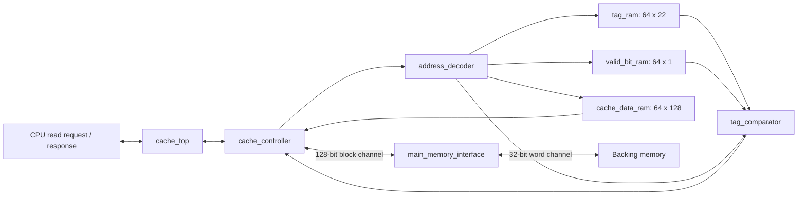
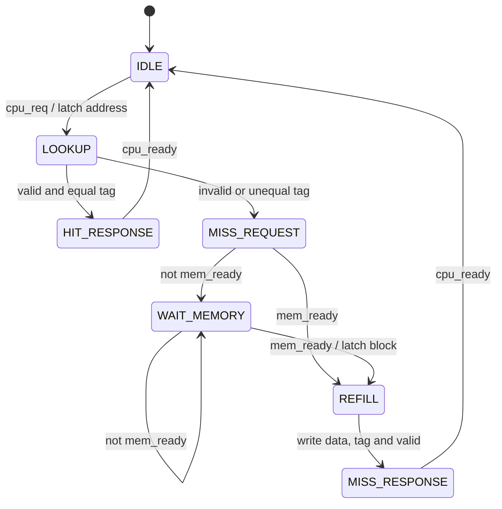
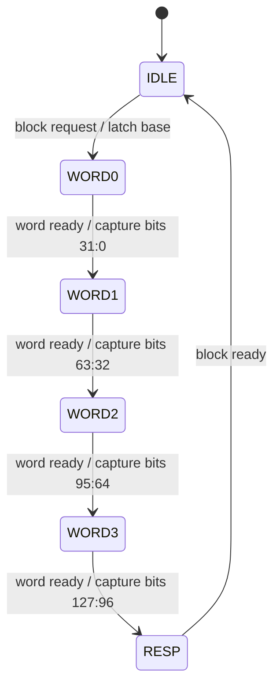

# Architecture and microarchitecture

The read-only, blocking direct-mapped cache accepts one outstanding CPU read. Capacity is 1,024 data bytes: 64 lines × 16 bytes. Data storage is 8,192 bits, tags are 1,408 bits, and valid storage is 64 bits (9,664 bits total before controller registers). Byte-address fields are tag [31:10], index [9:4], word [3:2], byte [1:0]. The supported CPU operation is an aligned 32-bit load; the decoder exposes byte offsets but no byte extraction, write policy, coherence, or cross-word unaligned load is implemented.

`cache_controller` owns the decoder, comparator and three storage modules; `cache_top` instantiates the controller and refill interface. The behavioral `main_memory_model` is outside the synthesizable hierarchy. It supplies an address-dependent default data pattern and test overrides.

Reset returns the FSM to IDLE and clears all valid bits; tag/data RAM contents need not be cleared. A reset during refill aborts the outstanding request. The external memory must also cancel its old transaction on reset (as the supplied model does).

Acceptance occurs on a rising edge with `cpu_req && !cpu_stall`. The CPU may then drop the request; keeping it high when IDLE is reached accepts another transaction. `cpu_ready` is a one-cycle response with stable data; stall remains asserted during the response state. The latched request address isolates processing from changes to the CPU address while busy.

Cache arrays have combinational reads and synchronous full-block writes. The controller captures hit data after LOOKUP and misses after REFILL. Hit latency is two cycles from acceptance to the response-sampling edge; the test driver includes an idle issue interval, so total elapsed trace cycles are not simply summed response latencies.

Each WORD state sends one request using `req_sent`, then waits for ready. Addresses are base+0,+4,+8,+12. The refill is `{word3,word2,word1,word0}`. The interface supports same-cycle combinational ready and delayed one-cycle ready pulses. It assumes no unsolicited memory responses and a single outstanding word transaction.
